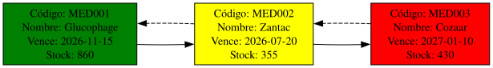

# Carga Masiva de Medicamentos

El usuario al elegir la opción 2 será llevado a un menú de carga para archivos **.csv**, al igual que en la carga individual de medicamentos, el archivo deberá contener los encabezados con los términos exactos presentados en la carga individual para hacer una asociación correcta.

| codigo | nombre | principio_activo | laboratorio | precio_unitario | cantidad | fecha_vencimiento | nivel_minimo |
| --- | --- | --- | --- | --- | --- | --- | --- |
| MED001 | Glucophage | Metformina | BioFarma | 3.90 | 860 | 2026-11-15 | 600 |
| MED002 | Zantac | Ranitidina | GenericLab | 6.30 | 355 | 2026-07-20 | 350 |
| MED003 | Cozaar | Losartán | CardioMed | 8.20 | 430 | 2027-01-10 | 450 |

---
## Explicación de la Lectura de Archivos CSV
Con la librería **Text::CSV** se obtiene el método "**new()**" y con el los parámetros "*binary => 1*" y "*auto_diag => 1*" que permiten leer caracteres *UTF-8* e identificar errores de mal formateo respectivamente.
A la vez se obtiene el método "**getline()**" que permite leer y almacenar en un arreglo los nombres de las columnas, este arreglo se usa como punto de referencia en un foreach para leer el resto de líneas y asociar su contenido con su columna asociada correctamente.
Se declara un *hash* "**%dato**" para guardar los datos en una sola línea y para a continuación hacer una asignación *hash-array*.
En código se ve de la siguiente manera:
```perl
while (my $fila = $csv->getline($fh)) {
    my %dato;
    @dato{@$encabezado} = @$fila;  # Crear hash en memoria para cada encabezado
    push @datos, \%dato;
}
```
Visualmente con un ejemplo sencillo podría verse de la siguiente forma:
```python
  encabezado = ["codigo", "nombre", "precio_unitario"]
  fila = ["MED001", "Paracetamol", 15.49]
  # resultado tras el push:
  %dato = (
    codigo => "MED001",
    nombre => "Paracetamol",
    precio_unitario => "15.49"
  )
```

---
## Almacenamiento de Información
El formato de almacenamiento de los datos es en archivos **JSON**, estos tienen una limitación, no se puede hacer carga de datos y que se agreguen al final, en su lugar, por cada nueva carga se sobreescribe totalmente la información. Lo anterior, en principio puede provocar perdida de información, la solución planteada fue hacer una copia del archivo y almacenarla en memoria RAM utilizando la lista doblemente enlazada desarrollada en "[utilidades/lista_doblemente_enlazada](../../gestion_datos/lista_doblemente_enlazada.pm)", para utilizarla se genera una instancia dentro de "**registrar_medicamento()**" con:
```perl
my $lista = gestion_datos::lista_doblemente_enlazada->nuevo(); # Creación de la lista, no global, sin dupeos
```
Además, se utiliza el método "**copiar()**" que se ubica dentro de "[utilidades/copiar_contenido_json](../../utilidades/copiar_contenido_json.pm)" el cual recibe cuatro datos y devuelve la misma lista anterior pero con los datos copiados de la siguiente forma:
```perl
my $copia_inventario = [];
my $ruta = 'administrador/Inventario/inventario.json';
my $metodo = "insertar_final";
utilidades::copiar_contenido_json::copiar($copia_inventario, $ruta, $metodo, $lista);
```
Después de eso, es utiliza el método "**insertar_final**" de la lista para ingresar los datos del formulario asociándolos a un **ID** específico en el archivo de la siguiente manera:
```perl
foreach my $medicamento ( @$medicamentos ) {
    $lista->insertar_final($medicamento);
  } # Usar mismo proceso para validar usuarios
```
Con lo hecho anteriormente, ya tenemos todos los datos almacenados en la lista, por lo que ya solo tenemos que usar el método "**almacenar_array_simple()**" de la lista para convertir los datos a texto plano que puede ser almacenado en el archivo gracias al método "**guardar_json()**" que esta en el archivo "[utilidades/leer_json](../../utilidades/leer_json.pm)" y que sirve para ingresar los datos.

---
## Reportes de Graphviz
Este apartado genera tres archivos, un archivo **.dot** asociado a graphviz con todas las instrucciones necesarias y apoyado por la lista doblemente enlazada para dar forma al gráfico, y dos archivos de imagen, un arhivo **.png** por los requerimientos del proyecto y una imagen de formato vectorial **.svg** por razones de gusto del desarrollador, para ello se llama al método "**generar_diagrama_inventario()**" dentro de "[reportes/inventario_dots.pm](../../reportes/inventario_dots.pm)" y que se invoca de la siguiente manera:
```perl
my $nombre_tiempo = strftime("%Y-%m-%d", localtime);
my $numero_pseudo_aleatorio = time();
my $name_dot = "reportes/archivos_dots/Inventario/inventario_$nombre_tiempo-$numero_pseudo_aleatorio.dot";
my $name_png = "reportes/imagenes/Inventario/PNG/inventario_$nombre_tiempo-$numero_pseudo_aleatorio.png";
my $name_svg = "reportes/imagenes/Inventario/SVG/inventario_$nombre_tiempo-$numero_pseudo_aleatorio.svg";
  reportes::inventario_dots::generar_diagrama_inventario($lista, $name_dot, $name_png, $name_svg);
```
Este es un ejemplo del resultado generado:
<p align="center">
  
</p>
