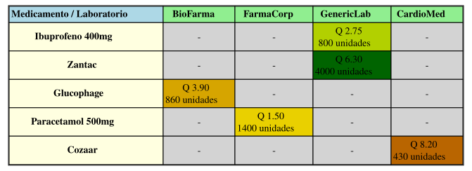

# Consultar Inventario
El administrador al elegir la opción 7 será llevado a un formulario con dos opciones, ver el contenido del inventario por código de medicamento o generar un reporte que utiliza una matriz dispersa para leer el contenido del inventario usando el nombre de los medicamentos como columnas y el nombre de los laboratorios fabricantes como filas.

## Obtener filas y columnas
Para este apartado, se utiliza la subrutina ["limites"](../../administrador/Consultas/modulos/obtener_f_c.pm) que lee el archivo del inventario utilizando un "foreach" identificando cada nueva instancia de códigos y laboratorios, con esto consiguiendo listar en un hash ambos parámetros y obtener un contador para cada uno:
```perl
  foreach my $nombre ( @$nombres ) {
    $n_cantidad++;
  }
  foreach my $laboratorio ( @$laboratorios ) {
    $l_cantidad++;
  }
  return ($n_cantidad, $l_cantidad);
```

## Uso de la matriz dispersa
Con los dos parámetros anteriores la matriz dispersa es creada con el número de columnas y de filas definidas por los contadores anteriores, luego se usan los métodos "**nombre_filas**" y "**nombre_columnas**" con "hashes" que contengan la información para delimitar la dimensión.
Se utiliza la subrutina ["llenar"](../../administrador/Consultas/modulos/llenar_matriz.pm) tras haber delimitado el área de la matriz, esta subrutina obtiene la matriz vacía y la ruta del inventario. Con un "foreach" para cada instancia en el inventario se obtienen los datos individualmente y se posicionan las coordenadas `$idx_f` y `$idx_c` y luego se insertan estos datos en la matriz.
```perl
    if ( defined $idx_f && defined $idx_c ) {
      $matrix->insertar($idx_f, $idx_c, $precio, $cantidad, $cantidad_minima);
    } else {
      warn "No se pudo insertar datos en la matriz dispersa...\n";
    }
```

## Ver información por nombre
El sistema recorrerá las columnas identificando si el nombre ingresado por el administrador existe en el inventario, si existe mostrará en formato de lista los siguientes valores:
| Laboratorio | Precio | Cantidad |
| - | - | - |
| String | Int | Int |

Si no existen datos para el nombre solicitado devolverá al administrador a su menú de forma segura.

## Reportes de Graphviz
Este apartado genera tres archivos, un archivo **.dot** asociado a graphviz con todas las instrucciones necesarias y apoyado por la lista circular simple para dar forma al gráfico, y dos archivos de imagen, un archivo **.png** por los requerimientos del proyecto y una imagen de formato vectorial **.svg** por razones de gusto del desarrollador, para ello se llama al método "**generar_diagrama_inventario()**" dentro de "[reportes/consultas_administrador_dot.pm](../../reportes/consultas_administrador_dot.pm)" y que se invoca de la siguiente manera:
```Perl
sub generar_imagenes {
  my ($ruta_dot, $ruta_png, $ruta_svg) = @_;

  my $cmd_png = "dot -Tpng -Gcharset=UTF-8 -Gdpi=150 '$ruta_dot' -o '$ruta_png' 2>&1";
  my $resultado_png = $cmd_png;

  ...

  my $cmd_svg = "dot -Tsvg -Gcharset=UTF-8 '$ruta_dot' -o '$ruta_svg' 2>&1";
  my $resultado_svg = `$cmd_svg`;

  ...
}
```
Este es un ejemplo del resultado generado:
<p align="center">
  
</p>


---
### Regresar al menú de administración

