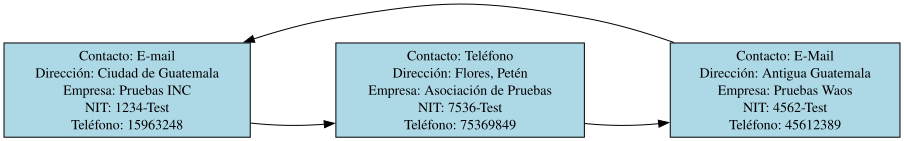

# Gestionar Proveedores

Si el administrador elige la opción 3 será llevado a un formulario donde deberá llenar lo siguiente:

| Información Ingresada | Tipo de Dato |
| --------------- | --------------- |
| NIT | String |
| Nombre de la Empresa | String |
| Contacto Principal | String |
| Número de Teléfono | Int (Longitud = 8) |
| Dirección | String |

---
## Validación de Datos
El "**NIT**" se podría considerar como el punto clave para cada proveedor, por lo tanto, no pueden existir múltiples proveedores con los mismos NITs, para ello utilizamos la subrutina "**validar_nit()**" del archivo "[comprobaciones.pm](../../administrador/Proveedores/comprobaciones.pm)", esta subrutina recibe la lista circular con los datos en memoria y el NIT a comprobar, si se detecta que un NIT idéntico existe en el archivo "[proveerdores.json]("../../administrador/Proveedores/proveedores.json")" se retorna un "*false*" y se le informa al administrador que ese NIT ya existe, puede agregar otro o ingresar la palabra reservada `Cancelar` para volver al menú del administrador de forma segura.

El número de teléfono es considerado un número entero [Ver explicación](registrar_medicamento.md#validación-de-datos), que solo es válido si tiene una longitud exacta de 8 caracteres y no se ha repetido en otro proveedor, sin embargo, si se puede agregar el mismo número de teléfono para dos instancias de proveedores distintas si se vuelve a ingresar el mismo número de teléfono por segunda vez a modo de confirmación.

---
## Módulo de Proveedores
Dentro del archivo "[proveerdores.pm]("../../administrador/Proveedores/proveedores.pm")" creamos la subrutina "**gestionar_proveedor()**" en la cual invocamos al archivo "[formulario_proveedores.pm]("../../administrador/Proveedores/formulario_proveedores.pm")" y sus subrutinas para leer el archivo "**proveedores.json**" usando a la [Lista Circular Simple]("../../gestion_datos/lista_circular_simple.pm"), lista la cual posee una instancia en el archivo "**proveedores.pm**", mientras que a su vez usamos la misma lista para volver a llenar el archivo "**proveedores.json**".

Dentro de la subrutina dedicada a leer el archivo "**proveedores.json**" utilizamos el método "*limpiar()*" de la lista circular, para eliminar posibles datos residuales que hayan quedado en memoria RAM dentro de la lista, después de eso, usando el método "*insertar_nuevo()*" dentro de un foreach asociado al contenido del archivo de los proveedores, esto sirve para cargar y duplicar todos los datos presentes en el archivo. Como se menciona en la entrada de la carga de medicamentos, cada vez que se cargan datos en archivos JSON se pierde su información anterior, por lo que hay que hacer un duplicado.

Dentro del formulario para nuevos proveedores solicitamos la información que mencionamos antes y la ingresamos en la lista circular de la siguiente manera:
```Perl
$lista_circular->insertar_nuevo({
    NIT => $nit,
    Empresa => $nombre_empresa,
    Contacto => $contacto_principal,
    Telefono => $telefono_num,
    Direccion => $direccion,
    Entregas => []
});
```
El espacio de "**Entregas => []**" no se solicita aquí, sin embargo, lo dejamos registrado para evitar solapamiento con la siguiente interacción del administrador, que es de registrar nuevas entregas.
Al igual que con la carga de medicamentos, usamos el método "**almacenar_array_simple()**" de la lista circular para convertir la información almacenada en los nodos a texto plano que gracias al método "[guardar_json](../../utilidades/leer_json.pm)" del archivo "**leer_json.pm**" podemos volver a almacenar la información actualizada en el archivo "**proveedores.json**".

---
## Reportes de Graphviz
Este apartado genera tres archivos, un archivo **.dot** asociado a graphviz con todas las instrucciones necesarias y apoyado por la lista circular simple para dar forma al gráfico, y dos archivos de imagen, un archivo **.png** por los requerimientos del proyecto y una imagen de formato vectorial **.svg** por razones de gusto del desarrollador, para ello se llama al método "**generar_diagrama_inventario()**" dentro de "[reportes/proveedores_dots.pm](../../reportes/proveedores_dots.pm)" y que se invoca de la siguiente manera:
```Perl
sub generar_imagenes {
  my ($ruta_dot, $ruta_png, $ruta_svg) = @_;

  my $cmd_png = "dot -Tpng -Gcharset=UTF-8 -Gdpi=150 '$ruta_dot' -o '$ruta_png' 2>&1";
  my $resultado_png = $cmd_png;

  ...

  my $cmd_svg = "dot -Tsvg -Gcharset=UTF-8 '$ruta_dot' -o '$ruta_svg' 2>&1";
  my $resultado_svg = `$cmd_svg`;

  ...
}
```
Este es un ejemplo del resultado generado:
<p align="center">
  
</p>

---
### Regresar al menú de administración

