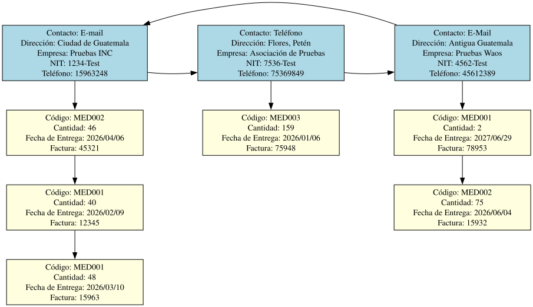
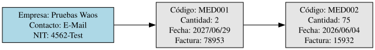

# Registrar Entrega de Proveedor

Si el usuario elige la opción 4 en el menú principal del administrador será redirigido a un formulario donde deberá llenar lo siguiente:
| Información Ingresada | Tipo de Dato |
| --------------- | --------------- |
| Código del Medicamento | String |
| Fecha de la Entrega | String |
| Número de Factura | Int |
| Cantidad a Ingresar | Int |

---
## Validación de Datos
- El código del medicamento es el identificador único de cada instancia, el sistema solo aprueba entregas para medicamentos ya existentes. Para validar esto se utiliza la subrutina "**identificar_codigo()**" del archivo [leer_inventario_json.pm](../../administrador/Inventario/leer_inventario_json.pm) el cual recibe el código a verificar y el tipo de usuario que esta haciendo la consulta, en este caso, al ser el administrador solo retornara un *true* si existe, de lo contrario le enviará de vuelta al menú de administración.
- La fecha de entrega, el número de factura y la cantidad ingresada utilizan subrutinas que contienen una o dos expresiones regulares para validar si son o no correctas. [Ver explicación más detallada](registrar_medicamento.md#validación-de-datos)
- La cantidad ingresada es el valor relevante para el inventario, pues al ser detectada, se utiliza la subrutina "**agregar_cantidad**" del archivo "**leer_inventario_json**", este internamente usa una lista doblemente enlazada para conectarse con el archivo [inventario.json](../../administrador/Inventario/inventario.json) para verificar el medicamento a modificar usando su código, al identificarlo utiliza la metodología de copiar y guardar la información existente de la [carga de medicamentos](registrar_medicamento.md#almacenamiento-de-información) para luego sumar la cantidad ingresada con la existente, luego vuelve a generar gráficos **graphviz** para actualizar el inventario.

---
## Módulo de Proveedores
En este apartado se utilizan listas circulares doblemente enlazadas y listas enlazadas simples de manera simultánea. Se requiere una validación inicial para comprobar que existan distribuidores registrados al leer el archivo [proveedores.json]('../../administrador/Proveedores/proveedores.json'), si se detectada que esta vacío se redirige al menú de administración, sino esta vacío, se solicita el **NIT** del proveedor que va a realizar una entrega, si no se encuentra, se le notifica al administrador y se le regresa al panel de administración, si existe, puede proseguir.

Inicialmente se carga la [lista circular simple]('../../gestion_datos/lista_circular_simple.pm') obteniendo y copiando los datos del archivo "**proveedores.json**" para almacenarlos en memoria RAM, esa información es redirigida a la subrutina "[formulario_nueva_entrega()]('../../administrador/Proveedores/formulario_entrega.pm')" donde se realiza el formulario obteniendo los datos de la entrega, estos datos se almacenan dentro de una lista simple que luego es adjuntada al modulo "*Entregas*" de la lista circular para luego ser guardado en el archivo "**proveedores.json**" de la siguiente forma:
```Perl
my $lista_simple_entregas = gestion_datos::lista_simple->nuevo();

# ... formulario ... #

if ( exists $proveedor->{Entregas} ) { 
# Busca el módulo Entregas dentro de proveedor dado y empieza a inyectar la información de la entrega
    foreach my $entrega ( @{$proveedor->{Entregas}} ) {
      $lista_simple_entregas->insertar_nuevo($entrega);
	}
}

$lista_simple_entregas->insertar_nuevo({
    Codigo => $codigo_medicamento,
    Cantidad => $cantidad,
    FechaDeEntrega => $fecha_entrega,
    Factura => $factura
}); 

$proveedor->{Entregas} = $lista_simple_entregas->almacenar_array_simple();
```

---
## Reportes de Graphviz
Este apartado genera tres archivos, un archivo **.dot** asociado a graphviz con todas las instrucciones necesarias y apoyado por la lista circular simple y la lista enlazada simple para dar forma al gráfico, y dos archivos de imagen, un archivo **.png** por los requerimientos del proyecto y una imagen de formato vectorial **.svg** por razones de gusto del desarrollador, para ello se llama al método "**generar_diagrama_inventario()**" dentro de "[reportes/proveedores_entregas_dots.pm](../../reportes/proveedores_entregas_dots.pm)" y que se invoca de la siguiente manera:
```Perl
my $nombre_tiempo = time();
my $nit = $proveedor->{NIT};

my $fecha = strftime("%Y-%m-%d", localtime);
my $dot_provs = "reportes/archivos_dots/Proveedores/proveedores_$fecha-$nombre_tiempo.dot";
my $png_provs = "reportes/imagenes/Proveedores/PNG/proveedores_$fecha-$nombre_tiempo.png";
my $svg_provs = "reportes/imagenes/Proveedores/SVG/proveedores_$fecha-$nombre_tiempo.svg"; 
  reportes::proveedores_dots::generar_diagrama_proveedores($lista_circular, $dot_provs, $png_provs, $svg_provs);

my $dot_entrega = "reportes/archivos_dots/Entrega_Proveedor/entregas_$nit-$nombre_tiempo.dot";
my $png_entrega = "reportes/imagenes/Entrega_Proveedor/PNG/entregas_$nit-$nombre_tiempo.png";
my $svg_entrega = "reportes/imagenes/Entrega_Proveedor/SVG/entregas_$nit-$nombre_tiempo.svg"; 
	reportes::proveedores_entregas_dots::generar_diagrama_entregas($proveedor, $dot_entrega, $png_entrega, $svg_entrega);
```
Este es un ejemplo del resultado que se genera en el listado de los proveedores:
<p align="center">
  
</p>
Este es un ejemplo del resultado que se genera para un proveedor y sus entregas:
<p align="center">
  
</p>

---
### Regresar al menú de administración

