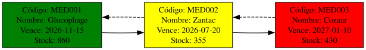

# Registrar Medicamento

El usuario al elegir la opción 1 del menú del administrador será llevado a un formulario donde deberá llenar lo siguiente:
| Información Ingresada | Tipo de Dato |
| ---- | ---- |
| Código del Medicamento | String |
| Nombre Comercial | String |
| Principio Activo | String |
| Laboratorio Fabricante | String |
| Precio del Medicamento | Float |
| Cantidad a Registrar | Int |
| Fecha de Vencimiento | String |
| Cantidad Mínima Permitida en Existencias | Int |

---
## Validación de Datos
Derivado al bajo tipado existente en Perl se tuvo que crear los archivos "[utilidades/fecha_regex](../../utilidades/fecha_regex.pm)" y "[utilidades/validar_numeros](../../utilidades/validar_numeros.pm)", ambos archivos se basan en la comprobación si los datos ingresados por consola coinciden con un formato definido por una expresión regular.
Validar números:
```perl
our $int_positivo_regex = qr/^\d+$/; 
our $float_positivo_regex = qr/^\d+(?:\.\d+)?$/;
```
Validar fecha:
```perl
our $fecha_regex = qr/^(199[0-9]|20[0-4][0-9]|2050)\/(0[1-9]|1[0-2])\/([0-2][0-9]|3[0-1])$/;
```
En donde **qr/...$/** es un operador propio de Perl que facilita la compilación de la expresión regular, **^** es un operador que encarga de usar el método regex, es decir, de izquierda a derecha, y los tokens **\/** son delimitadores entre expresiones.
Para los números, **d+** define números enteros únicamente positivos, si se coloca **-(d+)** estarías permitiendo números desde el infinito negativos hasta el infinito positivo, para plantear números decimales se agrega **(?:\.\d+)?**, la expresión regular espera que haya cero o un punto después del primer entero, si ocurre, debe haber otro número entero seguido de este siendo este el carácter decimal del número. 
Para las fechas, según lo definido en el archivo **CSV** de prueba, el formato es **Año/Mes/Día**, este es sencillo de entender, como ejemplo, **199[0-9]** explica que puede ser desde 1990 hasta 1999, si no se cumple uno de esos pasa a la siguiente posibilidad leída como **ó**, **20[0-4][0-9]**, este es más curioso, pues son válidas todas las combinaciones que se dan entre juntar los números de 0 al 4 para el tercer dígito, y de 0 al 9 para el cuarto dígito. Para el resto funciona exactamente igual, comprueba si la combinación de dígitos es posible, sino, devuelve falso y no deja continuar el llenado de formulario.

---
## Almacenamiento de Información
El formato de almacenamiento de los datos es en archivos **JSON**, estos tienen una limitación, no se puede hacer carga de datos y que se agreguen al final, en su lugar, por cada nueva carga se sobreescribe totalmente la información. Lo anterior, en principio puede provocar perdida de información, la solución planteada fue hacer una copia del archivo y almacenarla en memoria RAM utilizando la lista doblemente enlazada desarrollada en "[utilidades/lista_doblemente_enlazada](../../gestion_datos/lista_doblemente_enlazada.pm)", para utilizarla se genera una instancia dentro de "**registrar_medicamento()**" con:
```perl
my $lista = gestion_datos::lista_doblemente_enlazada->nuevo(); # Creación de la lista, no global, sin dupeos
```
Además, se utiliza el método "**copiar()**" que se ubica dentro de "[utilidades/copiar_contenido_json](../../utilidades/copiar_contenido_json.pm)" el cual recibe cuatro datos y devuelve la misma lista anterior pero con los datos copiados de la siguiente forma:
```perl
my $copia_inventario = [];
my $ruta = 'administrador/Inventario/inventario.json';
my $metodo = "insertar_final";
utilidades::copiar_contenido_json::copiar($copia_inventario, $ruta, $metodo, $lista);
```
Después de eso, es utiliza el método "**insertar_final**" de la lista para ingresar los datos del formulario asociándolos a un **ID** específico en el archivo de la siguiente manera:
```perl
$lista->insertar_final({ 
    codigo => $codigo_medicamento, 
    nombre => $nombre_comercial, 
    principio_activo => $principio_activo,
    laboratorio => $lab_fabricante,
    precio_unitario => $precio,
    cantidad => $cantidad,
    fecha_vencimiento => $fecha_vencimiento,
    nivel_minimo => $cantidad_minima
});
```
Con lo hecho anteriormente, ya tenemos todos los datos almacenados en la lista, por lo que ya solo tenemos que usar el método "**almacenar_array_simple()**" de la lista para convertir los datos a texto plano que puede ser almacenado en el archivo gracias al método "**guardar_json()**" que esta en el archivo "[utilidades/leer_json](../../utilidades/leer_json.pm)" y que sirve para ingresar los datos.

---
## Reportes de Graphviz
Este apartado genera tres archivos, un archivo **.dot** asociado a graphviz con todas las instrucciones necesarias y apoyado por la lista doblemente enlazada para dar forma al gráfico, y dos archivos de imagen, un archivo **.png** por los requerimientos del proyecto y una imagen de formato vectorial **.svg** por razones de gusto del desarrollador, para ello se llama al método "**generar_diagrama_inventario()**" dentro de "[reportes/inventario_dots.pm](../../reportes/inventario_dots.pm)" y que se invoca de la siguiente manera:
```perl
my $nombre_tiempo = strftime("%Y-%m-%d", localtime);
my $numero_pseudo_aleatorio = time();
my $name_dot = "reportes/archivos_dots/Inventario/inventario_$nombre_tiempo-$numero_pseudo_aleatorio.dot";
my $name_png = "reportes/imagenes/Inventario/PNG/inventario_$nombre_tiempo-$numero_pseudo_aleatorio.png";
my $name_svg = "reportes/imagenes/Inventario/SVG/inventario_$nombre_tiempo-$numero_pseudo_aleatorio.svg";
  reportes::inventario_dots::generar_diagrama_inventario($lista, $name_dot, $name_png, $name_svg);
```
Este es un ejemplo del resultado generado:
<p align="center">
  
</p>
