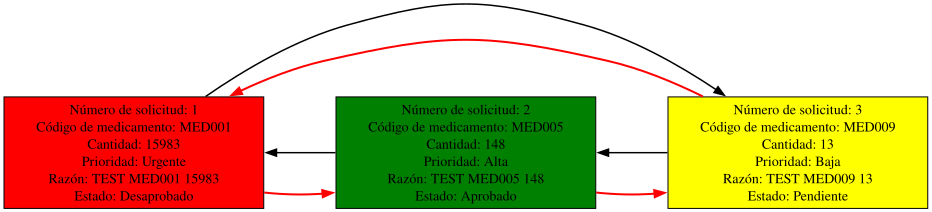

# Procesar Solicitudes de Reabastecimiento

Si el administrador elige la opción 5 será llevado al menú de gestión de reabastecimiento departamental. 

En este apartado, si existen solicitudes el usuario podrá decidir entre sí (Y) o no (N) para pasar al proceso de gestión, es un proceso individual uno a uno, las solicitudes irán siendo gestionadas en orden de asignación. Si decide no pasar a la gestión será devuelto al menú de administrador. Si decide verificar la solicitud será llevado a un formulario de si o no donde se mostrarán los datos de la solicitud almacenados en el archivo asociado al departamento solicitante, el directorio esta bajo el estándar "**administrador/Reabastecimiento/Inventario_Departamental/NOMBRE_DEPARTAMENTO/solicitudes_reabastecimiento.json**".

| Variables de la solicitud | Tipo de dato |
| - | - |
| Solicitud de nivel | Urgente - Alta - Media - Baja |
| Departamento solicitante | String |
| Medicamento requerido | String |
| Cantidad requerida | Int |
| Fecha de solicitud | YYYY/MM/DD |
| Razón de la solicitud | String |

## Verificar si hay solicitudes
Al seleccionar la opción 5, el sistema lleva al administrador al módulo de verificación en ["reabastecimiento.pm"](../../administrador/Reabastecimiento/reabastecimiento.pm), automáticamente el sistema comprueba si el archivo de ["*solicitudes_reabastecimiento.json*"](../../administrador/Reabastecimiento/solicitudes_reabastecimiento.json) tiene datos usando el método [contar_pendientes](../../administrador/Inventario/buscar_medicamento_codigo.pm), el cual recibe la ruta del archivo a evaluar, obtiene la información con el lector de archivos JSON, luego indexa el número de vueltas que da el foreach para aumentar un contador que indica el número de solicitudes pendientes, si este número es mayor que 0 se procede a preguntar al administrador si desea verificar la consulta.

## Solicitud Aprobada
En la subrutina principal ["procesar_solicitud"] de "reabastecimiento.pm" se obtiene la información de la primera instancia del archivo "solicitudes_reabastecimiento.json" con la subrutina ["mostrar_info"](../../administrador/Reabastecimiento/reabastecimiento_modulos/mostrar_info), esta información es:
```perl
my ($codigo, 
    $prioridad, 
    $codigo_depto, 
    $nombre_med, 
    $cantidad, 
    $fecha_solicitud, 
    $razon, 
    $codigo_unico) = administrador::Reabastecimiento::reabastecimiento_modulos::mostrar_info::mostrar_info();
```
La misma información es enviada a la subrutina ["aprobado"](../../administrador/Reabastecimiento/reabastecimiento_modulos/aprobado.pm) para identificar el medicamento del que se ha hecho una solicitud dentro del archivo ["inventario.json"](../../administrador/Inventario/inventario.json), se debe identificar la cantidad en existencias, si esta es menor a "**$cantidad**" siendo esta la cantidad solicitada por el departamento entonces el programa automáticamente cancelara y desaprobará la solicitud.

Si hay suficiente "stock" en el inventario, la solicitud en el archivo de solicitudes del departamento será marcada como "**Aprobada**", la misma instancia será eliminada del historial del administrador. Para lograr esto se ha empleado una [lista circular doblemente enlazada]("../../gestion_datos/lista_circular_doblemente_enlazada.pm") principalmente con sus métodos "**cambiar_estado_multi_parametro**" y "**eliminar_multi_parametro**", ambos métodos deben recibir todos los parámetros obtenidos con "mostrar_info" para garantizar que no se ha confundido con otra instancia del mismo departamento, el uso de "**$codigo_unico**" para esta tarea es clave.

Finalmente, se construye los reportes gráficos tanto en formato PNG como SVG donde se representa el cambio de estado de "Pendiente" a "Aprobado".

## Solicitud Desaprobada
Al igual que con la aprobación de los datos, la misma información se envía a la subrutina ["desaprobado"](../../administrador/Reabastecimiento/reabastecimiento_modulos/desaprobado.pm) donde se cambia el estado a "**Desaprobado**" y utilizando la lista circular doblemente enlazada se eliminan y modifican los archivos .json correspondientes. Al final, igualmente se generan los reportes gráficos representando el estado de "Pendiente" a "Desaprobado".

## Reportes de Graphviz
Este apartado genera tres archivos, un archivo .dot asociado a graphviz con todas las instrucciones necesarias y apoyado por la lista circular doblemente enlazada para dar forma al gráfico, y dos archivos de imagen, un archivo .png por los requerimientos del proyecto y una imagen de formato vectorial .svg por razones de gusto del desarrollador, para ello se llama al método "generar_diagrama_solicitud_reabastecimiento()" dentro de "reportes/reabastecimiento_dots.pm" y que se invoca de la siguiente manera:
```perl
sub generar_imagenes {
  my ($dot_file, $png_file, $svg_file) = @_;

  my $cmd_png = "dot -Tpng -Gcharset=UTF-8 -Gdpi=150 '$dot_file' -o '$png_file' 2>&1";
  my $resultado_png = `$cmd_png`;

  ...

  my $cmd_svg = "dot -Tsvg -Gcharset=UTF-8 '$dot_file' -o '$svg_file' 2>&1";
  my $resultado_svg = `$cmd_svg`;

  ...
}
```

Este es un ejemplo del resultado generado:
<p align="center">
  
</p>

---
### Regresar al menú de administración

