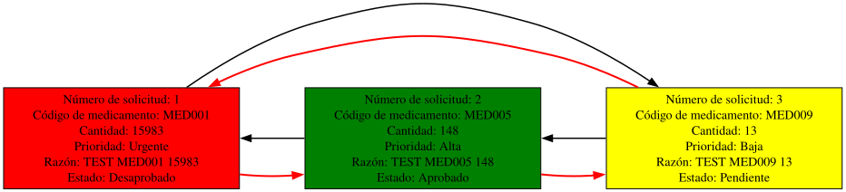

# Solicitar Reabastecimiento
Cuando el usuario llega a este apartado deberá llenar un formulario con los siguientes datos:
| Código del medicamento | Cantidad requerida | Prioridad | Razón de la solicitud |
| - | - | - | - |
| String | Int | Int (1 - 4) | String |

Primero se hará una comprobación usando el lector de archivos JSON con respecto al código ingresado, si este coincide con alguna instancia le deja ingresar el resto de datos, de lo contrario será enviado nuevamente a su interfaz.
Para asociar un entero del uno al cuatro en el apartado de prioridad se usa un modulo "clave-valor":
```perl
sub clave_valor {
  my ($clave) = @_;
  my @valores = (
    {clave => 1, valor => "Urgente"},
    {clave => 2, valor => "Alta"},
    {clave => 3, valor => "Media"},
    {clave => 4, valor => "Baja"}
  );
  
  foreach my $valor ( @valores ) {
    if ( $clave == $valor->{clave} ) {
      return $valor->{valor}
    }
  }
}
```

Con esos datos obtenidos se formatea la fecha de entrega siempre al momento de ejecución del programa con `my $fecha_solicitud = localtime->strftime("%Y/%m/%d");`.

## Lista Circular Doblemente Enlazada
Cuando los datos anteriormente mencionados están correctamente alojados en memoria, se envían a la subrutina ["agregar"](../../usuario/reabastecimiento/operar_lista_cde.pm) dentro de "**operar_lista_cde**", en este apartado se manejan dos listas circulares doblemente enlazadas, ambas con el mismo funcionamiento, almacenar esta información e inyectarla en archivos JSON, una es para las solicitudes a nivel departamental y la otra es para englobar todas las solicitudes para que el administrador pueda elegir entre aprobarla o no.
Se debe detectar si existen los directorios para almacenar la información existen, de lo contrario se crean con `make_path($directorio)` siendo "$directorio" la ruta de asociada a cada departamento.
Utilizando el lector de archivos JSON para archivos posiblemente vacíos se carga la información en memoria, cada instancia es valuada con un foreach a las listas circulares doblemente enlazadas en función del estado de la instancia, si es "**Pendiente**" se carga en ambas listas, sino, solo en la lista departamental asegurando la limpieza de la lista administrativa.
```perl
  my $lista_admin = gestion_datos::lista_circular_doblemente_enlazada->nuevo();
  my $lista_doblemente_enlazada = gestion_datos::lista_doblemente_enlazada->nuevo();

  # ...

  if ( $solicitud->{estado} eq "Pendiente" ) {
    $lista->insertar_final($solicitud);
    $lista_admin->insertar_final($solicitud);
  } else {
    $lista->insertar_final($solicitud);
  }
```
Se cargan los datos nuevos de la reciente solicitud usando el método "**insertar_final**" de la lista, estos datos se indexan en una variable tipo hash usando el método "**almacenar_array_simple**" y finalmente se generan los reportes gráficos.
```perl
  my $datos = $lista->almacenar_array_simple();
  my $datos_admin = $lista_admin->almacenar_array_simple();
  utilidades::leer_json::guardar_json($ruta, $datos);
  utilidades::leer_json::guardar_json($copia_admin, $datos_admin);

  my ($nombre_dot, $nombre_png, $nombre_svg) = reportes::nombre_archivos::nombre("Solicitud_Reabastecimiento", "solicitud_pendiente");
  reportes::reabastecimiento_dots::generar_diagrama_solicitud_reabastecimiento($lista, $nombre_dot, $nombre_png, $nombre_svg);
```

## Reportes de Graphviz
Este apartado genera tres archivos, un archivo **.dot** asociado a graphviz con todas las instrucciones necesarias y apoyado por la lista circular doblemente enlazada para dar forma al gráfico, y dos archivos de imagen, un archivo **.png** por los requerimientos del proyecto y una imagen de formato vectorial **.svg** por razones de gusto del desarrollador, para ello se llama al método "**generar_diagrama_inventario()**" dentro de "[reportes/proveedores_dots.pm](../../reportes/proveedores_dots.pm)" y que se invoca de la siguiente manera:
```Perl
sub generar_imagenes {
  my ($ruta_dot, $ruta_png, $ruta_svg) = @_;

  my $cmd_png = "dot -Tpng -Gcharset=UTF-8 -Gdpi=150 '$ruta_dot' -o '$ruta_png' 2>&1";
  my $resultado_png = $cmd_png;

  # ...

  my $cmd_svg = "dot -Tsvg -Gcharset=UTF-8 '$ruta_dot' -o '$ruta_svg' 2>&1";
  my $resultado_svg = `$cmd_svg`;

  # ...
}
```
Este es un ejemplo del resultado generado:
<p align="center">
  
</p>


---
### Regresar al menú de usuario

