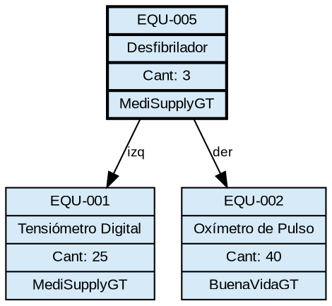
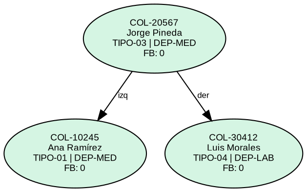
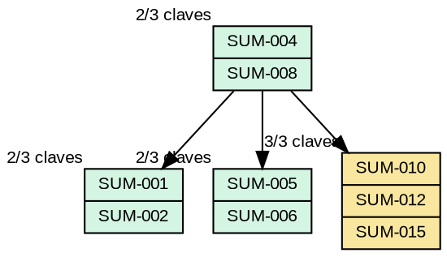
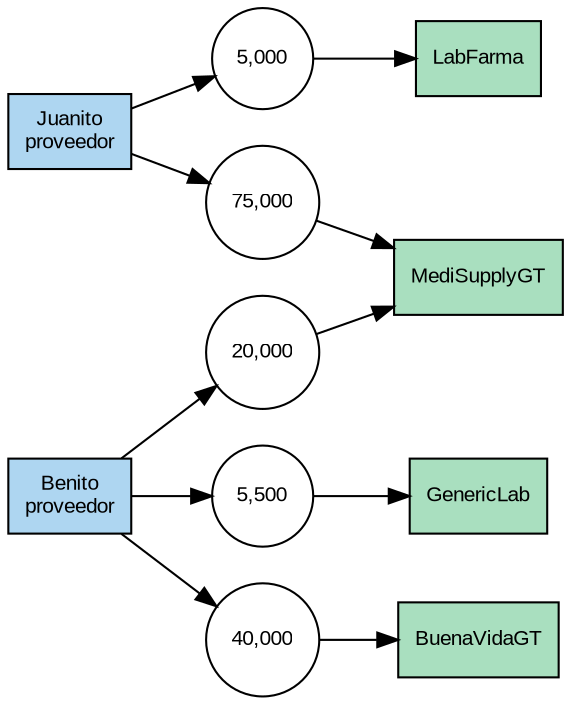

# Reportes Gráficos con Graphviz

Todos los reportes se generan mediante la herramienta `dot` de Graphviz. El sistema Perl produce un archivo `.dot` con la descripción del grafo y ejecuta el comando para generar la imagen PNG, que luego se muestra en la interfaz mediante un `Gtk3::Image`.

Los reportes se regeneran automáticamente cada vez que se modifica la estructura correspondiente.

---

## Generación de imágenes

```perl
sub generar_imagen {
    my ($ruta_dot, $ruta_png) = @_;
    my $cmd = "dot -Tpng -Gcharset=UTF-8 -Gdpi=150 '$ruta_dot' -o '$ruta_png' 2>&1";
    my $salida = `$cmd`;
    if ($? != 0) {
        warn "Error al generar imagen: $salida";
    }
}
```

---

## Reporte Árbol BST

Muestra la estructura completa del Árbol BST de equipos médicos.

**Especificaciones visuales:**
- Nodos rectangulares con la información del equipo (código, nombre, cantidad, fabricante).
- Aristas etiquetadas: `izq` hacia hijo izquierdo, `der` hacia hijo derecho.
- La raíz se distingue con borde más grueso.
- Los nodos hoja tienen fondo de color diferenciado.

**Ejemplo de archivo `.dot` generado:**



---

## Reporte Árbol AVL

Muestra la estructura del Árbol AVL con el personal médico autorizado.

**Especificaciones visuales:**
- Nodos **circulares** (`shape=circle` o `shape=ellipse`).
- Cada nodo muestra: número de colegio (clave), nombre completo, tipo y departamento.
- Se indica el **factor de balance** de cada nodo entre paréntesis.
- Aristas etiquetadas `izq` y `der`.

**Ejemplo de archivo `.dot` generado:**



---

## Reporte Árbol B Orden 4

Muestra la estructura del Árbol B con los suministros médicos.

**Especificaciones visuales:**
- Nodos como **bloques horizontales segmentados** (`shape=record`), con una celda por clave.
- Flechas descendentes hacia cada hijo.
- Se indica el número de claves actuales y la capacidad máxima (ej. `2/3`).
- **Código de colores:**
  - 🟡 Amarillo (`#F9E79F`) — nodo con 3 claves (al límite).
  - 🟢 Verde (`#D5F5E3`) — nodo con espacio disponible.

**Ejemplo de archivo `.dot` generado:**



---

## Reporte Matriz Dispersa

Visualiza la matriz dispersa de proveedores vs. fabricantes. Solo se representan las celdas con valores distintos de cero.

**Especificaciones visuales:**
- **Nodos cabecera de fila** (proveedores): rectángulos con borde azul.
- **Nodos cabecera de columna** (fabricantes): rectángulos con borde verde.
- **Nodos de valor**: círculos que contienen la cantidad total entregada.
- Conexiones horizontales desde la cabecera de fila hacia los nodos de valor.
- Conexiones verticales desde los nodos de valor hacia las cabeceras de columna.

**Ejemplo de archivo `.dot` generado:**



---

## Reporte Lista Doblemente Enlazada (Medicamentos)

Reporte heredado de la Fase 1. Muestra cada medicamento como un nodo rectangular con flechas bidireccionales entre nodos consecutivos.

---

## Reporte Lista Circular Doblemente Enlazada (Proveedores)

Reporte heredado de la Fase 1, actualizado para la lista circular **doble**. Muestra los proveedores como nodos en un anillo con flechas en ambos sentidos y la conexión del último nodo de vuelta al primero.

---

## Visualización en la interfaz

El administrador accede a todos los reportes desde el botón **Reportes** del panel. Se abre una subventana con pestañas, una por cada reporte. Las imágenes PNG se cargan en un `Gtk3::Image` dentro de un `Gtk3::ScrolledWindow` para permitir desplazamiento en reportes grandes.

```perl
sub mostrar_reporte {
    my ($ruta_png) = @_;
    my $imagen   = Gtk3::Image->new_from_file($ruta_png);
    my $scroll   = Gtk3::ScrolledWindow->new;
    $scroll->set_policy('automatic', 'automatic');
    $scroll->add($imagen);
    return $scroll;
}
```

---

[← Volver al README principal](../README.md)
